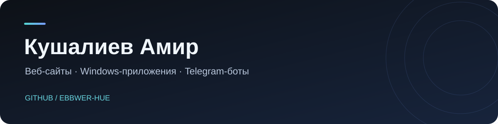

  

Создаю веб-сайты, приложения для Windows и Telegram-ботов. В этом профиле — мои проекты: от шахматных инструментов до обработки видео и помощника с несколькими AI-провайдерами.

### Технологии

### Проекты

| Проект | Что делает | Технологии |
| :--- | :--- | :--- |
| [Мозг](https://github.com/ebbwer-hue/mozg) | Помощник с несколькими AI-провайдерами, голосовым вводом и Markdown | Node.js, JavaScript |
| [Chess Studio](https://github.com/ebbwer-hue/chess-studio) | Локальные шахматы и анализ позиций Stockfish | Node.js, JavaScript, Stockfish |
| [Chess Helper](https://github.com/ebbwer-hue/chess-helper) | Telegram-бот для распознавания доски и разбора позиций | Python, OpenCV, Stockfish |
| [Activity Switcher](https://github.com/ebbwer-hue/activity-switcher) | Собственная карточка активности в Discord | C#, Windows Forms, RPC |
| [Video Banner](https://github.com/ebbwer-hue/video-banner) | Подготовка видео и наложение баннерной рекламы | C#, FFmpeg, yt-dlp |
| [Polyclinic SQL](https://github.com/ebbwer-hue/polyclinic-sql) | Учебная база поликлиники с примерами запросов | T-SQL, SQL Server |

### Веб-проекты Бибигуль Кушалиевой

- [Персональный сайт спикера](http://speaker.bkushalieva.ru/) — адаптивный сайт с программами, выступлениями, интервью и книгой.
- [Когнитивный капитал](http://kapital.bkushalieva.ru/) — основной сайт программы.
- [Страница Black Friday](https://kapital-black-friday-2026.briscoefelipe4291n9a.chatgpt.site/black-friday/) — отдельная страница акции с таймером, ценой и условиями.

### Связь

**Кушалиев Амир** · **[@foidslayer1038](https://t.me/foidslayer1038)**
